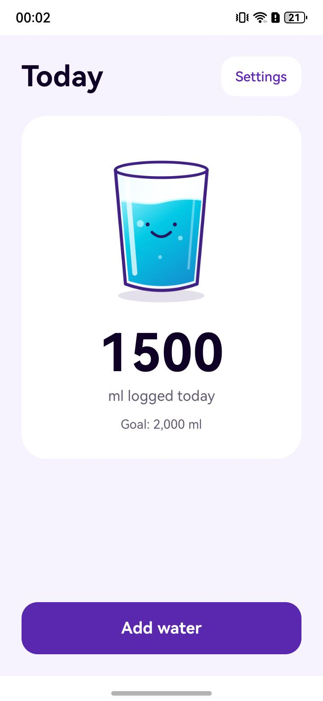

# Water Tracker

Water Tracker is an OpenHarmony phone and tablet example for logging daily water intake and sharing state between an ArkUI interface and persistent storage.

## What this example demonstrates

| Capability | API or platform service | Where to look |
| --- | --- | --- |
| Show today's total and update it when water is added | ArkUI `LocalStorage`, `@LocalStorageProp`, and `@LocalStorageLink` | [Index.ets](entry/src/main/ets/pages/Index.ets), [AddWaterMenu.ets](entry/src/main/ets/pages/AddWaterMenu.ets) |
| Change the large and small glass sizes | ArkUI `@LocalStorageLink` | [SettingsMenu.ets](entry/src/main/ets/pages/SettingsMenu.ets) |
| Restore and save the daily total and glass sizes | `@kit.ArkData` Preferences | [WaterKeeper.ets](entry/src/main/ets/entryability/WaterKeeper.ets) |

## Preview



## Requirements

- OpenHarmony 6.1 (API 23) SDK and command-line tools. The build profile compiles and targets API 23 and declares compatibility from API 18.
- Node.js 22, Java 17, and `@oniroproject/oniro-app` 0.10.0 match the CI build setup.
- An OpenHarmony phone, tablet, or emulator to run the app. The module declares `default` and `tablet` device types.
- Local development signing for a device build. The app declares no permissions and needs no external service.

## Build and run

From the repository root in PowerShell:

```powershell
npm install -g @oniroproject/oniro-app@0.10.0
oniro-app sdk install 6.1
oniro-app cmdtools install
Copy-Item build-profile.example.json5 build-profile.json5
oniro-app sign
oniro-app build
```

The example profile contains no signing credentials. Copy it and run `oniro-app sign` once per checkout; signing updates its configuration and creates local signing files. The local `build-profile.json5` and `signatures/` are ignored by Git. Later builds need only `oniro-app build`.

Connect an OpenHarmony device or start an emulator, then use `oniro-app devices` to find its serial. Run `oniro-app app install --device SERIAL` and `oniro-app app launch --device SERIAL`, replacing `SERIAL` with that value.

## Use

1. Open **Add water**. Choose large or small glasses, enter a custom amount, or combine them, then tap **Add**.
2. Check the updated total on **Today**. The glass illustration changes as the total approaches the fixed 2,000 ml goal.
3. Open **Settings** to change the large and small glass sizes. Return to **Add water** to see the new amounts.

## Explore the implementation

[EntryAbility.ets](entry/src/main/ets/entryability/EntryAbility.ets) creates the shared `LocalStorage` and loads the home page. [WaterKeeper.ets](entry/src/main/ets/entryability/WaterKeeper.ets) loads values from Preferences, publishes them to the UI, and flushes them when the app enters the background or the day changes. [Utility.ets](entry/src/main/ets/model/Utility.ets) defines the keys, default glass sizes, and goal. See [the implementation guide](docs/implementation.md) for the data flow.

## Verify

`oniro-app build` should finish with **BUILD SUCCESSFUL**. On a device or emulator, add water and check that the Today total changes. Change a glass size in Settings and check its value on Add water. Send the app to the background, relaunch it, and check that the total and glass sizes return.

## Limitations

- Only the current day's total is shown. The app stores totals under date keys, but has no history screen.
- The 2,000 ml goal is fixed in code.
- Preferences are flushed when the app enters the background or the date changes; a sudden termination before either event can lose recent changes.

## Contributing

These apps are focused examples of specific platform capabilities. Contributions that keep an example correct, buildable, and clear are welcome, including bug fixes, documentation and setup corrections, and improvements to its existing behavior. Please keep pull requests within the app's stated purpose and describe how you verified the change.

**Found a problem but can't fix it?** Open an issue in this repository; a pull request is not required. For a bug or broken build, include the steps to reproduce it, what you expected, what happened, and your device, OS, and SDK/API version. Logs or screenshots are helpful when available. You can also open an issue for inaccurate or unclear documentation.

## License

This project is licensed under the Apache License, Version 2.0. See [LICENSE](LICENSE).
