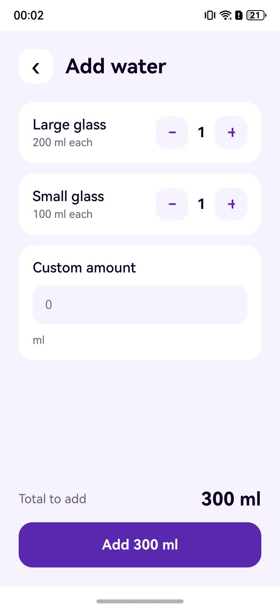
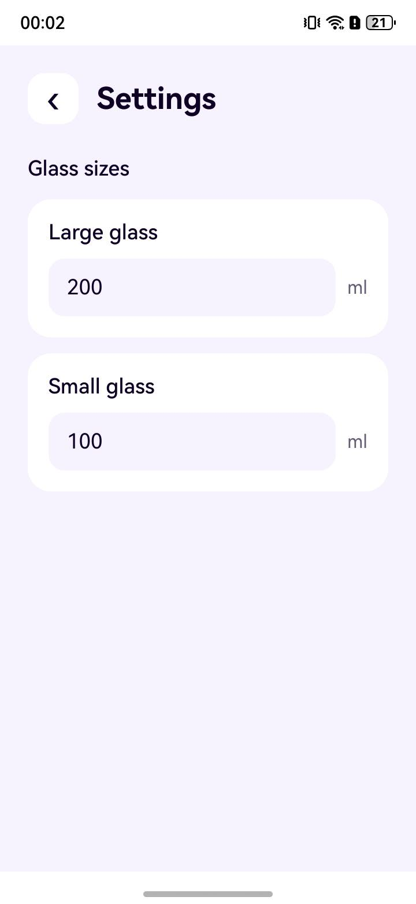

# How Water Tracker shares and saves data

Water Tracker keeps the displayed values in ArkUI `LocalStorage` and stores selected values in Preferences. The pages respond to changes in the shared storage; `WaterKeeper` handles loading, saving, and switching to a new day.

## Startup

1. [EntryAbility.ets](../entry/src/main/ets/entryability/EntryAbility.ets) creates a `LocalStorage` instance when the ability is initialized, passes it to `WaterKeeper` in `onCreate`, and supplies it to `windowStage.loadContent`.
2. [WaterKeeper.ets](../entry/src/main/ets/entryability/WaterKeeper.ets) first publishes default glass sizes, a zero daily total, and `data_ready = false`. The buttons remain disabled while stored data loads.
3. It calls `preferences.getPreferences(context, 'water')` from `@kit.ArkData`. It reads the saved glass sizes and today's total, using 200 ml, 100 ml, and 0 ml when keys are absent. The date key uses `Date.toLocaleDateString('en-GB')`.
4. It copies those values into `LocalStorage` and sets `data_ready = true`.

The storage keys and default values are defined in [Utility.ets](../entry/src/main/ets/model/Utility.ets).

## From a tap to the Today screen

[AddWaterMenu.ets](../entry/src/main/ets/pages/AddWaterMenu.ets) keeps the selected glass counts and custom amount as page state. It calculates the amount to add from those counts and the current glass sizes. Tapping **Add** increases the shared `water_level` through `@LocalStorageLink` and returns to the home page.

[Index.ets](../entry/src/main/ets/pages/Index.ets) observes `water_level` through `@LocalStorageProp`. It shows the total and chooses one of five glass images according to fixed thresholds. The displayed goal is 2,000 ml.

The Add water and Settings pages use `@LocalStorageLink` for values they change. [SettingsMenu.ets](../entry/src/main/ets/pages/SettingsMenu.ets) accepts positive numeric glass sizes and updates the shared defaults. `@LocalStorageProp` is used for read-only values such as `data_ready`.

## Persistence and day changes

`WaterKeeper` writes the two glass sizes and the current day's total to Preferences with asynchronous `put` calls, then awaits `flush`. [EntryAbility.ets](../entry/src/main/ets/entryability/EntryAbility.ets) requests this save in `onBackground`. The app does not flush Preferences on every tap.

`WaterKeeper` also schedules a check around the next midnight and checks the date when the app returns to the foreground. If the date changed, it saves the previous day's values, reads the new date's total (or zero), and updates `LocalStorage`. The app only displays the current day's total; there is no history view.

## Phone screenshots

The Add water screen calculates the amount before it is added to today's total:

Settings shows the glass sizes used by that calculation:

## Try the flow

1. Launch the app and wait for **Add water** and **Settings** to become available.
2. Add a large glass. The Today total should increase by the large glass size.
3. Change that size in Settings, then add another large glass. The second increase should use the new size.
4. Send the app to the background and relaunch it. The total and glass sizes should be restored from Preferences.

These interactions require an OpenHarmony device or emulator. A successful build checks packaging and compilation, but does not check the runtime behavior.
